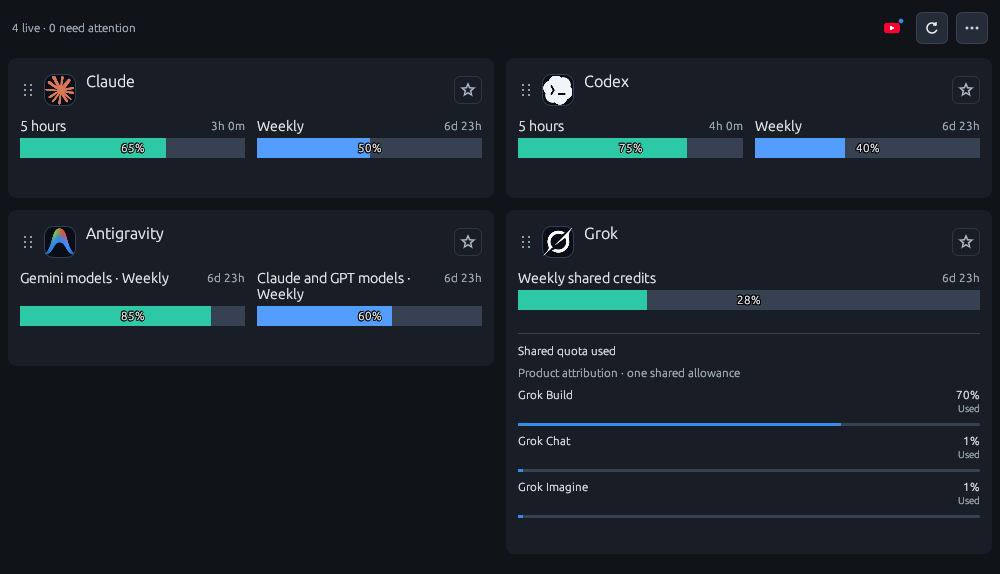

# Token Ashtray

**The tray app for token maxxers.**

All your limits. One tray.

A single-binary desktop app that shows how much of each AI subscription you have
left — Claude, Cursor, Codex, Grok, Copilot, Kimi and friends — as a tray icon
with one persistent board window that you can pin above other applications.

## Download and install

Verified Linux and Windows packages are published on the GitHub Releases page,
each with its SHA-256 checksum.

- [Linux downloads — GitHub Releases](https://github.com/rammicz/token-ashtray/releases) · [Linux installation guide](INSTALL-LINUX.md)
- [Windows downloads — GitHub Releases](https://github.com/rammicz/token-ashtray/releases) · [Windows installation guide](INSTALL-WINDOWS.md)

<picture>
  <source media="(max-width: 600px)" srcset="assets/screenshots/token-ashtray-board-narrow.png">
  
</picture>

*Synthetic example data.*

Linux x86_64 and Windows x64 are the release targets; macOS is unsupported.
The install guides cover prerequisites, per-user setup, manual updates and removal.

## Author and support

By Jirka Herník / @jirkahernik. [Support on Patreon](https://www.patreon.com/JirkaHernik)
or watch [YouTube](https://www.youtube.com/@jirkahernik). Patreon support is
voluntary; release downloads are free.

## First run

Token Ashtray has no account to create or API key to paste. It reuses existing
provider logins, with different sources for different services:

- **Claude, Codex, Grok and Kimi:** their first-party CLI login files. Follow the
  provider's reconnect instruction if a login is missing or expired.
- **Cursor and Grok Bot:** Cursor desktop sign-in, read from its local SQLite
  storage without writing to the database. Grok Bot shares the Cursor account.
- **GitHub Copilot:** an already configured `GITHUB_COPILOT_GITHUB_TOKEN`,
  `COPILOT_GITHUB_TOKEN`, `GITHUB_COPILOT_API_TOKEN`, or `GITHUB_TOKEN`
  environment value (in that order), existing CLI/editor `apps.json` /
  `hosts.json` login files, or a read-only GitHub CLI (`gh`) `hosts.yml`
  fallback (never reading OS keyrings). No token is requested by the app's UI.
- **Antigravity:** Antigravity CLI 1.1.11+ with a completed sign-in. The app invokes
  its read-only quota command; the CLI owns authentication and Token Ashtray
  does not read its OS credential store.
- **Mistral Vibe:** existing `MISTRAL_API_KEY` environment / `~/.vibe/.env` key,
  or the installed `mistral-vibe` CLI (`vibe-app-server`) with its existing
  sign-in (`vibe --setup`). As with Antigravity, the CLI owns keyring/OIDC
  authentication inside an isolated temporary `VIBE_HOME` and Token Ashtray
  never reads the OS credential store directly.

Missing logins show provider-specific reconnect guidance. Request failures stay
local to that provider. Non-auth failures can retain readings with their
original age/error state; unknown limits stay unknown. See [first-run and failure guidance](docs/DATA-SOURCES.md#first-run-and-provider-failures)
for login commands, credential paths, rate limits and current evidence limits.

## Using the board

X11 supports remembered board placement and always-on-top; Wayland disables
those client-controlled features and explains the compositor limitation.

Token Ashtray runs once per user session. Launching it again opens the running
board, restoring it if minimized, and starts nothing new. A login start finds
the running app and exits silently. On Wayland the compositor decides whether
an open board is raised or restored.

Settings persist provider order, visibility, primary tray provider, polling
interval, board geometry, pin and compact mode.
In the board **•••** menu, **Quota display** selects
**Remaining** (the default) or **Used**. Numbers, gauge fills and tray tooltips
change together using cached quota. Warning colors and tray burn still reflect
actual consumption; shared-product attribution always shows Used.
The choice is saved as `board.quota_display_mode = "remaining"` or `"used"` in
the existing per-user `config.toml`, so it survives restarts and executable
updates. Older configurations and unrecognized modes default to Remaining
without resetting the other settings.
Legacy configurations restore only the main board's ID 0 settings; detached
entries never reopen or supply defaults. Saves use `window` for geometry, pin
and compact mode. Unknown main-window fields move with it; unknown detached
fields remain inert under `panels` with their original IDs. Provider visibility
continues to use `board.hidden`.
The tray offers refresh, the board, autostart, About and Quit.
The board uses a responsive grid of quota gauges showing the selected meaning
(**Remaining** by default) and reset times. Click a gauge to open the provider's
usage page; when quota
is unavailable, click its provider name. The star selects the tray's primary
provider. Drag the dotted handle to move a full-card preview while nearby cards
make room. Release over another quota card or unavailable row in the same
section to save the shown order across restarts. Escape or release
outside a valid row to cancel; moving between the quota and unavailable
sections also cancels. Pinning, compact mode,
provider visibility and polling settings live in the toolbar's **•••** menu.
Hidden providers are not scheduled.
The lightweight tray process owns polling. The native board runs in a transient
child of the same executable and receives normalized data through private pipes;
closing the board releases its graphics memory. No credentials pass
to that child.

## Privacy and diagnostics

No telemetry, application account, cloud sync, web server or webview. Quota
requests go directly to the measured providers; required OAuth refreshes
preserve unrelated CLI credential fields and save atomically. Tokens and raw
response bodies are excluded from diagnostics. Error messages can identify
credential paths: review reports for local usernames or account details before
sharing them.

Provider usage pages and About's author links open in the system browser only
after an explicit action. The main-board latest-video action first makes a
bounded public YouTube feed request (5 seconds, 256 KiB, no redirects), then
opens the video or the author's videos page. Opening the board/About or hovering
does not fetch it. YouTube sees the client IP and application/version User-Agent;
browser pages follow the browser's own session/privacy settings. See the
[current network policy](docs/REQUIREMENTS.md#g7-network-scope-and-implementation-status).
Automatic updates are off by default. When turned on under **Updates** in the
window settings, the app checks the project's GitHub Releases once a day with
anonymous HTTPS requests and downloads only signed, verified releases; GitHub
sees the IP address, app version and platform. A verified update installs after
Quit, and only into an installation made by the Windows graphical setup or the
Linux per-user installation in `~/.local/opt/token-ashtray/`; other copies
never update themselves. No release is signed yet, so current builds report
that updates are unavailable and send no update request. Until then, update
with the install guides' manual steps.

## Development

See [build and run from source](docs/RELEASE.md#build-and-run-from-source) for
commands and release measurements, and [CONTRIBUTING.md](CONTRIBUTING.md) for
the checks to run before submitting a change. GitHub Actions remain disabled;
a tag push does not create packages. Every release candidate needs package and native installation checks. Windows
release verification is tracked in the [Windows checklist](docs/WINDOWS-ACCEPTANCE.md). Historical
provider evidence is in [Data sources](docs/DATA-SOURCES.md); it does not replace
verification of a new release candidate.

- [Requirements](docs/REQUIREMENTS.md)
- [Data sources and verification notes](docs/DATA-SOURCES.md)
- [Build, measurement and delivery](docs/RELEASE.md)
- [Dependency license review](docs/LICENSE-REVIEW.md)

## Licence

MIT. See [LICENSE](LICENSE). Copyright (c) 2026 Jiri Hernik
([original repository](https://github.com/rammicz/token-ashtray)). Third-party
components retain their own licenses and notices in [THIRD-PARTY.md](THIRD-PARTY.md).
