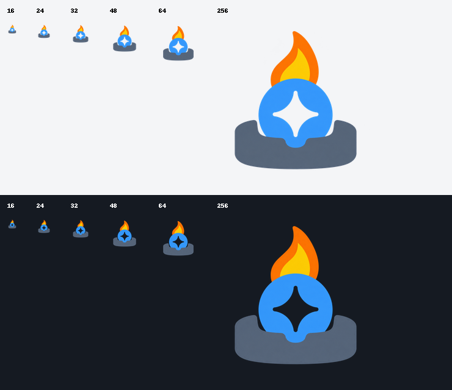

# Approved application artwork

The owner selected this generated image for the static application identity. `reference-original.png` is the source: 1254×1254 RGBA, 626038 bytes, SHA256 `3fa3552f44825f53b77397291673149242d602f9f0b5a7384381dd3a89997495`. It was imported from the verified intake copy, not regenerated. Only its embedded provenance metadata chunk was removed before publication; the decoded RGBA pixels (SHA256 `bf9b39fec5b08f0212d83feb627e44c8a8fe917f8bf9fac3c5324542c631d595`) are unchanged. The blue token, transparent four-point cutout, yellow/orange flame, gray ashtray, original canvas and proportions are retained.

Run `python3 scripts/export_application_icon.py` from a Python environment with Pillow 9.0.1 to reproduce the committed exports. It resamples the unchanged original using Lanczos in premultiplied RGBA, then converts back to straight RGBA. This avoids contaminating partially transparent edge pixels with invisible source RGB. There is no crop, repaint, source cleanup or alternate small-size drawing. Cargo builds consume committed files and need no Python or image tooling.

`exports.json` pins source, PNG file and decoded RGBA hashes and the final ICO hash. The ICO contains 32-bit DIB entries at 16/24/32/48/256, generated from the same exported pixels, including alpha and an AND mask. The runtime caches the 64px PNG embedded in the executable for the main board. The 256px PNG is the Linux launcher icon installed by the Linux packages. No adjacent file is required at application runtime.

The comparison places actual exports at 1:1 against `#f4f5f7` and `#151a22`, in size order 16/24/32/48/64/256. Native image dimensions are 740×640. Each row has labels at y12, images at y40, x starting 12 with 32px spacing. The lower row starts y320. It composites the unchanged exported PNGs solely for inspection. At 16px the flame and bowl remain distinct and the cutout remains open; larger sizes preserve the curved token, inner flame and bowl. No motif is clipped. The original's tiny disconnected colored marks are not visibly disruptive in these exports; no bitmap edit was needed. This comparison is asset evidence, not a native Windows screenshot.

Static application artwork is separate from the dynamic quota tray graphic. `src/icon_pixels.rs`, tray primary selection and remaining-quota encoding retain their prior pixel behavior.

The focused PE guard compares decoded resource pixels with the reviewed export hashes, so an old-artwork EXE with valid 16/24/32/48/256 dimensions fails. A local Windows GNU build establishes resource embedding only. Native Windows board/taskbar/Alt+Tab/Explorer/new Start shortcut at 100/150/200%, WM_GETICON/class icon, both startup modes, and the final product ZIP remain required acceptance; they are not established by these assets or GNU/Linux checks.
